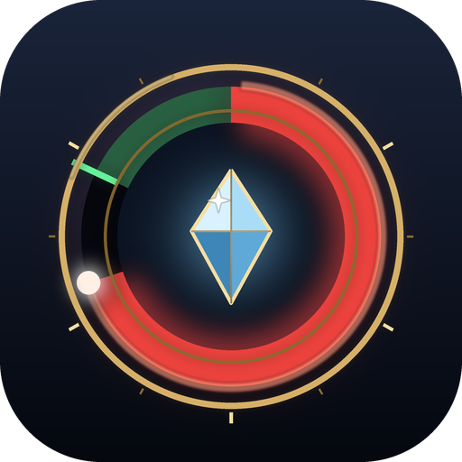

<p align="center">
  
</p>

# Chant

**A castbar that tells you when you can move, in the shape you like.**

A [Dalamud](https://github.com/goatcorp/Dalamud) plugin for Final Fantasy XIV that replaces the game's cast bar with one built to be read at a glance: red while moving would cancel your cast, a flash the moment it's safe to go, and your next action already lined up beside it. Pick a bar, a ring, an arc or a gauge beside your character, then make it your own.

[](https://githixypluginffxiv.vercel.app/plugins/chant)
[](https://www.patreon.com/GitHixy)
[](https://discord.gg/9kjUjWDBkJ)

[](LICENSE)


---

## What it does

### When can I move?

The game locks a cast in a little before its bar ends, and from then on you can move without cancelling it: the slidecast window. Chant makes it impossible to miss.

- **Hold still**: the bar leans red, and its frame glows red, while moving would cancel the cast.
- **Get ready**: a moment before the window opens, it turns amber.
- **Go**: the end of the bar is shaded as the window, with a bright line where it opens. When the fill reaches it, the bar snaps back to the spell's own colour, pulses, and the name gives way to **Move ›**.
- **Too early**: holding a movement key, pushing the stick or sliding before then turns it to the warning colour and shakes it, with **Don't move!** in place of the name.
- **Cancelled anyway**: Chant says how early you moved ("Moved 0.32s too early").

### What's next?

- The **queue window**, where the game starts accepting your next action, is marked on the bar and lights up once it's open.
- Once you've queued something, **its icon appears next to the castbar**.
- After instant actions the same shape shows the **global cooldown** rolling, thinner, in its own colour and labelled GCD so it never looks like a cast; it turns to the queue colour once the queue window opens, so it's useful on jobs that hardly cast.

### What am I casting?

The spell's icon and name, with the fill coloured by what it does:

| Colour group | What's in it |
| --- | --- |
| **Damage** | Spells cast at an enemy |
| **Healing** | Spells that restore HP |
| **Raise** | Raise, Resurrection, Ascend, Egeiro, Verraise, Angel Whisper |
| **Support** | Other spells on you or your party: summons, buffs, shields |
| **Everything else** | Mounts, items, teleports, crafting, gathering, quest actions |

### Seven presets, every shape

| Preset | Shape | The idea |
| --- | --- | --- |
| **Aether** | Bar, on screen | Brass-framed, icon on the left, name above. The all-rounder. |
| **Sigil** | Ring, on screen | Fills like a clock around the spell's icon. |
| **Halo** | Ring, follows you | A thin ring of light around your character. Eyes stay on the fight. |
| **Pillar** | Upright gauge, follows you | Fills from the bottom beside your character, icon on top. |
| **Crescent** | Arc, on screen | Cradles the icon like a crescent moon. |
| **Runic** | Long bar, on screen | Etched every half second, everything written inside. |
| **Whisper** | Hairline, on screen | Red means stay, a flash means go. Nothing else. |

Everything is yours to change, with a live preview: bar length and thickness and which way it fills, ring radius, thickness, where it starts and how much of the circle it covers; on screen or on your character at any height; every colour; where the icon, name and timer go, their fonts and size; ticks, glow, frame, pulse, shake and how long a finished cast lingers. Drag the castbar into place right on the screen. Every preset remembers your changes and its position, so you can switch back and forth freely. Save your own presets, and share any of them as a short code.

### Learn your slidecasts

**Settings → Timing** counts your session: casts, slidecasts, casts lost to moving, and on average how long before the end you started moving. If a cast gets cancelled when you moved *inside* your window, your connection needs a shorter one: Chant suggests the value and sets it with one click.

### Party raise watch

When someone in your party is raising, a small tag under the castbar says who is raising whom and how long is left. It turns gold when it's your current target, so two healers don't raise the same person. It's off by default: turn it on in **Settings → General**, and keep it under the castbar or drag it anywhere on screen with **Move castbar**.

### Also

- Hides the game's own cast bar while it draws in its place, and gives it back whenever it steps aside.
- An optional chime (one of the game's `<se>` sounds) the moment it's safe to move, for long casts.
- Only in combat, or leaving everyday casts (mounts, teleports, crafting) to the game, if you prefer.
- Follows Dalamud's reduced motion setting.

## Plays by the rules

Chant is purely visual.

- **It only shows what the game already shows you**: your own cast bar, the global cooldown on your hotbar, and the party list's cast bars. It reads input only to know whether you're moving.
- **It never acts for you.** No casting, queuing, moving or anything else is ever sent to the game.
- **It switches itself off in PvP**, and gets out of the way in cutscenes, in GPose and when you hide the game's UI. The game's own cast bar comes back whenever it does.
- **It stays on your machine.** No network requests, no data leaving your PC.

## Getting started

1. Install Chant from the plugin installer.
2. Type `/chant` and pick a preset.
3. Press **Test casts** to see it in action without a fight, and **Move castbar** to put it where you want it.

| Command | What it does |
| --- | --- |
| `/chant` | Open the settings |
| `/chant test` | Play sample casts on screen |
| `/chant move` | Drag the castbar into place (right-click it when done) |
| `/chant toggle` | Turn the castbar on or off |

## Something not working?

**Settings → Diagnostics** shows what Chant sees: the last cast, how it was classified and why, and whether you're moving. Turn on **Log casts**, make the problem happen, then **Copy report** and **Report a bug** opens a GitHub issue for you to paste it into. Or come and talk about it on [Discord](https://discord.gg/9kjUjWDBkJ).

## Building from source

Requires the .NET 10 SDK and a Dalamud dev environment.

```
dotnet build -c Release
```

The built plugin lands in `bin/Release/`. To run it as a dev plugin, copy `Chant.dll`, `Chant.deps.json` and `Chant.json` into `%AppData%\XIVLauncher\devPlugins\Chant\`, then reload it from `/xlplugins` → Dev Tools.

The icon is generated by `python tools/make_icon.py` (needs Pillow and NumPy).

### How it works

- Your cast comes from your character's cast information; the global cooldown, animation lock and queued action from the game's action manager, with addresses from [FFXIVClientStructs](https://github.com/aers/FFXIVClientStructs). All of it is only read.
- The queue window opens once nothing blocks you for longer than it: the cast, the global cooldown or an animation lock.
- Moving means a movement or jump key held (whatever you bound them to), the left stick pushed, or your position changing.
- Spells are sorted by who they can target and by their English tooltip, which reads the same whatever language the game runs in: aimed at an enemy is damage, "resurrects" is a raise, "restores HP" is a heal, the rest of the friendly spells are support.
- The castbar is drawn with ImGui on the background draw list, so it sits under Dalamud's windows and over the game.

## Also by GitHixy

- [LootView](https://github.com/GitHixy/LootView): a live loot tracker with history and statistics.
- [HitSpark](https://github.com/GitHixy/HitSpark): animated, styleable combat text.
- [FateLimit](https://github.com/GitHixy/FateLimit): see the edge of every FATE.
- [MoogleMap](https://github.com/GitHixy/MoogleMap): a see-through map over your screen.

## License

Chant is licensed under [GPL-3.0](LICENSE). The game's fonts are loaded from your installation and are not distributed with Chant.

---

*Not affiliated with Square Enix. FINAL FANTASY XIV © SQUARE ENIX CO., LTD.*
